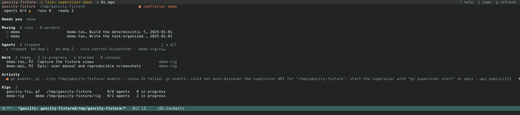

# gascity.el

⚠️ Status: Experimental

gascity.el is a [Magit](https://magit.vc/)-style Emacs porcelain for
[Gas City](https://github.com/gastownhall/gascity), the `gc` multi-agent
workspace manager, integrated with
[beads.el](https://github.com/r0man/beads.el). Gas City's `gc` CLI is the
*plumbing*; gascity.el is the *porcelain*: every view is a function of
`gc … --json` output, rendered keyboard-first in hand-built, sectioned
buffers rather than generated from command metadata. See
[docs/DESIGN.md](docs/DESIGN.md).

[](https://github.com/r0man/gascity.el/actions/workflows/test.yml)
[](https://github.com/r0man/gascity.el/actions/workflows/lint.yml)
[](https://github.com/r0man/gascity.el/actions/workflows/pages.yml)

[](doc/images/cockpit-dark.png)

## Install

Requirements: GNU Emacs 29.1+, the `gc` CLI on `exec-path`, and the
non-ELPA `beads.el` and `vui`. The full requirements and options are in
the [manual](https://r0man.github.io/gascity.el/).

### Guix

```sh
guix shell -D -f guix.scm
./autogen.sh
./configure --with-beads-dir="$HOME/workspace/beads.el"
make && make check
```

`guix build -f guix.scm` builds and installs the package the same way.
`guix.scm` packages the autotools build through `gnu-build-system`.
`beads.el`/`vui` stay outside Guix: the sibling `../beads.el` checkout is
read at **evaluation time** (`GASCITY_BEADS_DIR` overrides it), so it must
exist before `guix build` or `guix shell`. Pin it with `git-fetch` for a
checkout-free build.

### Building from source

The project is a GNU-style autotools project:

```sh
./autogen.sh
./configure --with-beads-dir="$HOME/workspace/beads.el"
make && make check && make install
```

`configure` defaults to the sibling `../beads.el` and fails, naming the
option, when `lisp/beads-meta.el` is missing. The `vui` bundled in that
checkout is used by default (`--with-vui-dir` overrides it) and
deliberately shadows any installed `emacs-vui`.

`transient` 0.10.1 or later is also required. Emacs 31+ bundles a new
enough copy; on Emacs 29.1-30 it comes from GNU ELPA (in CI,
`scripts/ci-deps transient` installs it into a throwaway directory and
exports `EMACSLOADPATH`). `--with-transient-dir=DIR` points the build at
one explicitly.

To run from a checkout without installing, put `lisp/` on `load-path` and
`(require 'gascity)`.

## Quick start

With a `gc` city running, `M-x gascity` opens the dispatcher and `M-x
gascity-dashboard` the city cockpit. Everywhere `g` refreshes, `q`
buries, `RET` drills in, and `?` lists the verbs at point.

## Manual

The manual is the full reference for every view, key binding, transient,
action verb, remote/TRAMP path, and workflow/sling/formula flow:

- On the web: <https://r0man.github.io/gascity.el/>
- In Emacs: `M-x info RET gascity RET` (source: `doc/gascity.texi`)

## Contributing

Run the quality gate from the repository root before pushing:

```sh
scripts/gate.sh   # make (warnings as errors) + make check (ERT)
scripts/lint.sh   # checkdoc + package-lint
```

Tests that need a live `gc` and a city guard themselves with
`skip-unless`. See the manual's *Contributing* chapter and
[AGENTS.md](AGENTS.md).

## License

GPL-3.0-or-later — see <https://www.gnu.org/licenses/gpl-3.0.html>.
